# KSSD-Net: Kolmogorov–Arnold Spatial–Spectral Denoising Network

KSSD-Net is a compact hyperspectral image denoising network that combines local spatial processing with bidirectional spectral modeling. It uses Chebyshev Kolmogorov–Arnold mappings to learn complementary corrections, which are combined through an input-adaptive gate.

## Network Architecture

  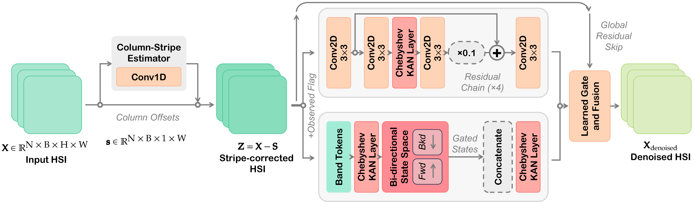

The input first passes through a column-stripe estimator. The corrected observations are then processed by two parallel branches:

- Spatial branch: convolutional processing and Chebyshev-KAN mappings capture local structures.
- Spectral branch: bidirectional state-space processing and Chebyshev-KAN mappings capture inter-band dependencies.
- Adaptive fusion: a learned gate balances the two corrections at each pixel and band.
- Auxiliary learning: masked reconstruction provides additional contextual supervision during training.

Column-stripe estimator

  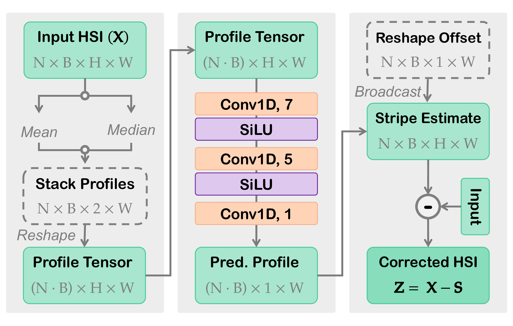

The estimator uses height-wise mean and median profiles to predict column offsets before spatial–spectral processing.

Bidirectional spectral state-space processing

  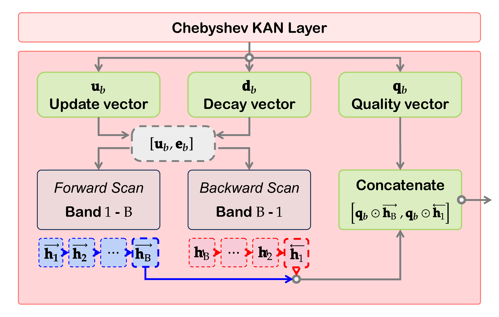

Forward and backward scans provide information from both directions along the spectrum.

Kolmogorov–Arnold mappings

  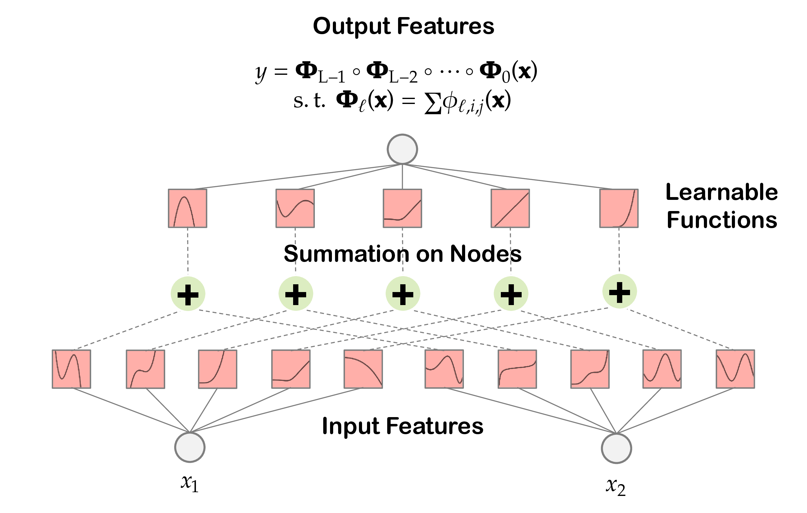

Chebyshev-KAN mappings are used in KSSD-Net

## Spatial and Spectral Context

HSI restoration benefits from both neighboring image measurements and relationships across spectral bands.

<table>
  <tr>
    <td align="center" width="50%">Spatial context</td>
    <td align="center" width="50%">Spectral context</td>
  </tr>
  <tr>
    <td align="center">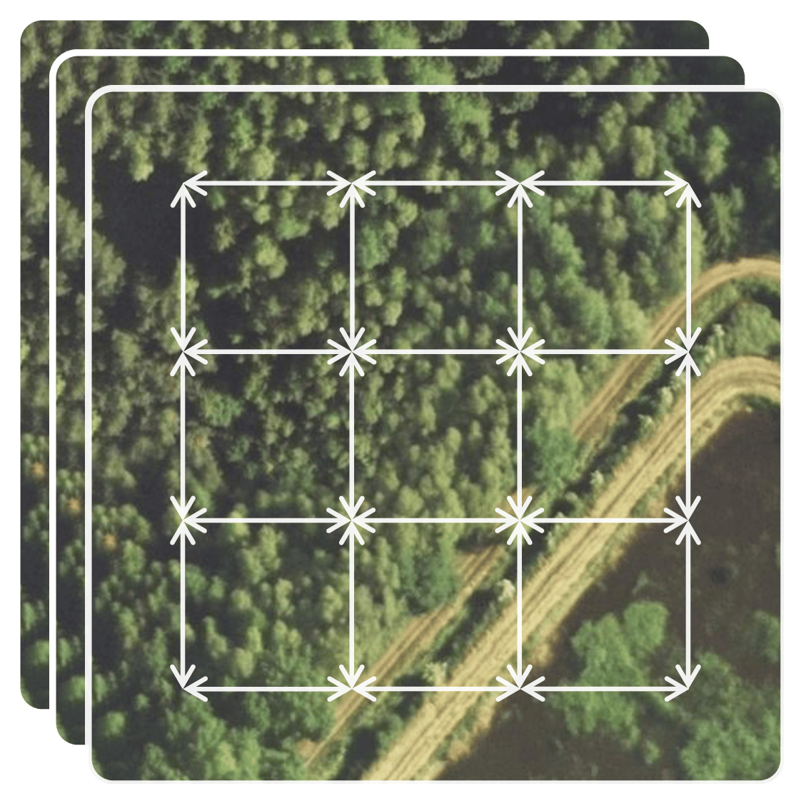</td>
    <td align="center">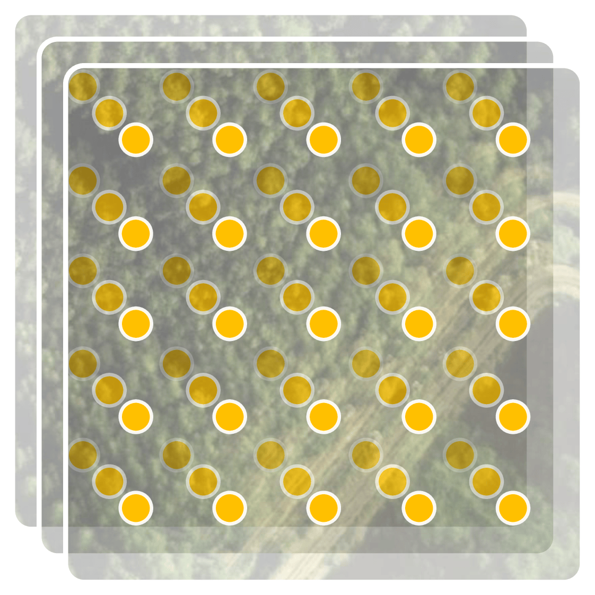</td>
  </tr>
</table>

## Illustrative Degradations

  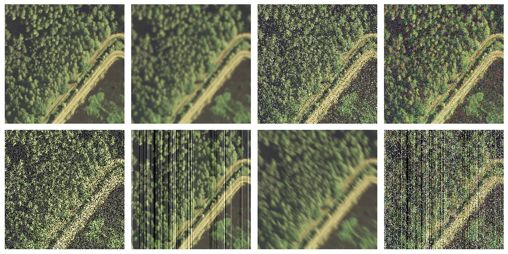

This illustration presents different image-degradation patterns.

## Datasets

Experiments use four Chandrayaan-1 M³ Level-2 reflectance products and eight Chandrayaan-2 IIRS Level-1 radiance products.

| Sensor | Measurement | Bands | Spectral range | Samples per line | Lines per product |
|---|---|---:|---|---:|---:|
| M³ | Reflectance | 85 | 0.46–2.98 µm | 304 | 24,414–30,250 |
| IIRS | Radiance | 256 | 0.8–5.0 µm | 250 | 8,821–55,461 |

Product identifiers and dimensions

### Chandrayaan-1 M³

| Product ID | Samples | Lines |
|---|---:|---:|
| `M3G20090622T042035_V01_RFL` | 304 | 24,414 |
| `M3G20090622T124051_V01_RFL` | 304 | 27,048 |
| `M3G20090623T012541_V01_RFL` | 304 | 30,250 |
| `M3G20090623T182551_V01_RFL` | 304 | 29,792 |

### Chandrayaan-2 IIRS

| Product ID | Samples | Lines |
|---|---:|---:|
| `ch2_iir_nci_20210112T0149187898_d_img_d32` | 250 | 55,430 |
| `ch2_iir_nci_20210112T0743064200_d_img_d32` | 250 | 55,430 |
| `ch2_iir_nci_20210113T0124245058_d_img_d32` | 250 | 55,461 |
| `ch2_iir_nci_20210611T0437452422_d_img_d32` | 250 | 55,394 |
| `ch2_iir_nci_20210611T0833509470_d_img_d32` | 250 | 55,428 |
| `ch2_iir_nci_20210612T0414261216_d_img_d32` | 250 | 55,360 |
| `ch2_iir_nci_20260908T0240355449_d_img_d18` | 250 | 8,821 |
| `ch2_iir_nci_20260908T0636269481_d_img_d18` | 250 | 8,971 |

## Compared Methods

KSSD-Net is evaluated against six classical and six deep-learning-based HSI denoising methods.

| Category | Method | Venue |
|---|---|---|
| Classical | E-3DTV | IEEE TIP, 2020 |
| Classical | ARSSC | IEEE TCYB, 2022 |
| Classical | WMLRTR | IEEE TCYB, 2023 |
| Classical | L0RLRTD | IEEE JSTARS, 2024 |
| Classical | HLTVSG | IEEE TGRS, 2025 |
| Classical | 3DTCTV | IEEE TGRS, 2025 |
| Deep learning | MAC-Net | IEEE TGRS, 2022 |
| Deep learning | DPNet-S | IEEE TGRS, 2023 |
| Deep learning | SST | AAAI, 2023 |
| Deep learning | SERT | CVPR, 2023 |
| Deep learning | S²OTAN | IEEE TGRS, 2024 |
| Deep learning | BTMnet | IEEE TGRS, 2025 |

## Quantitative Results

Evaluation covers six synthetic-noise settings: two Gaussian, two impulse, and two mixed-noise conditions. Mixed noise includes Gaussian, impulse, and column-stripe corruption.

### M³ Reflectance

  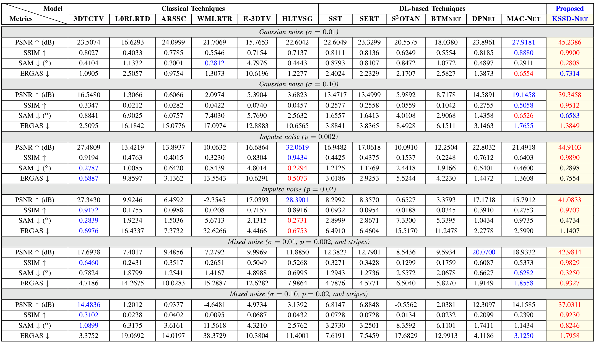

### IIRS Radiance

  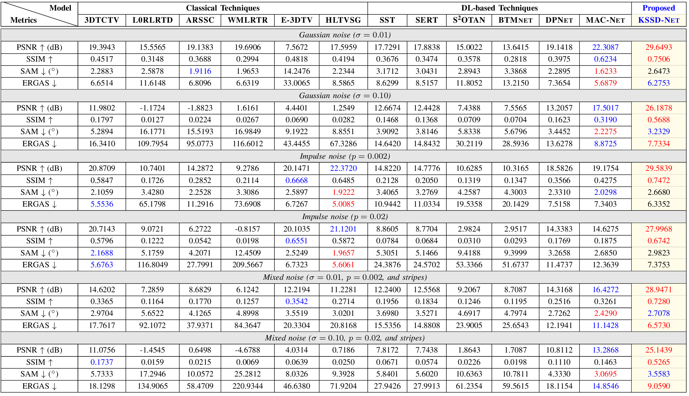

Higher PSNR and SSIM indicate better reconstruction, while lower SAM and ERGAS are preferred. KSSD-Net achieves the highest PSNR and SSIM in all evaluated conditions on both datasets. 

### Strong Mixed-Noise Summary

| Dataset | PSNR (dB) ↑ | SSIM ↑ | SAM (°) ↓ | ERGAS ↓ |
|---|---:|---:|---:|---:|
| M³ | 37.0311 | 0.9230 | 0.8246 | 1.7958 |
| IIRS | 25.1439 | 0.5265 | 3.5583 | 9.0590 |

## Restoration Examples

The following panels show the saved restoration visualizations for the two datasets. They are separate from the synthetic-corruption tables above.

### M³

  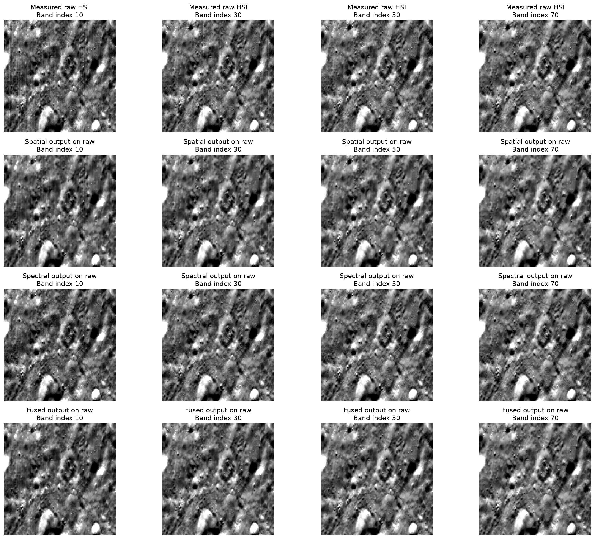

### IIRS

  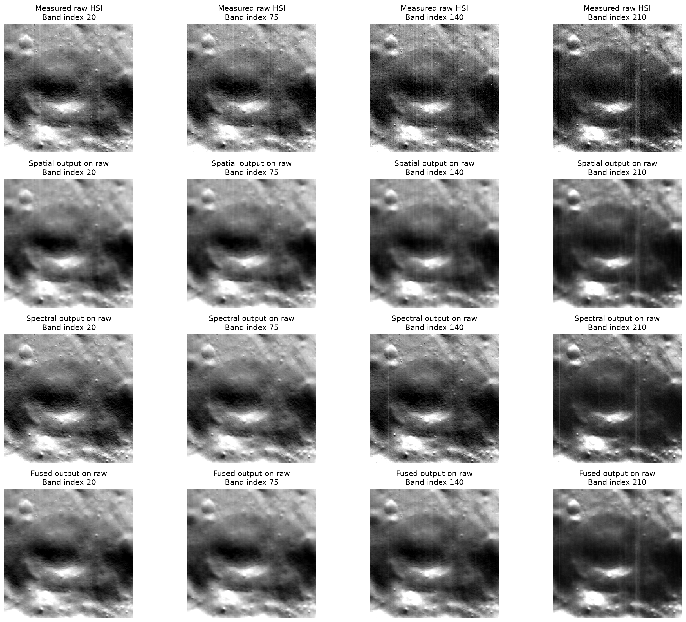

Residual visualizations

### M³

  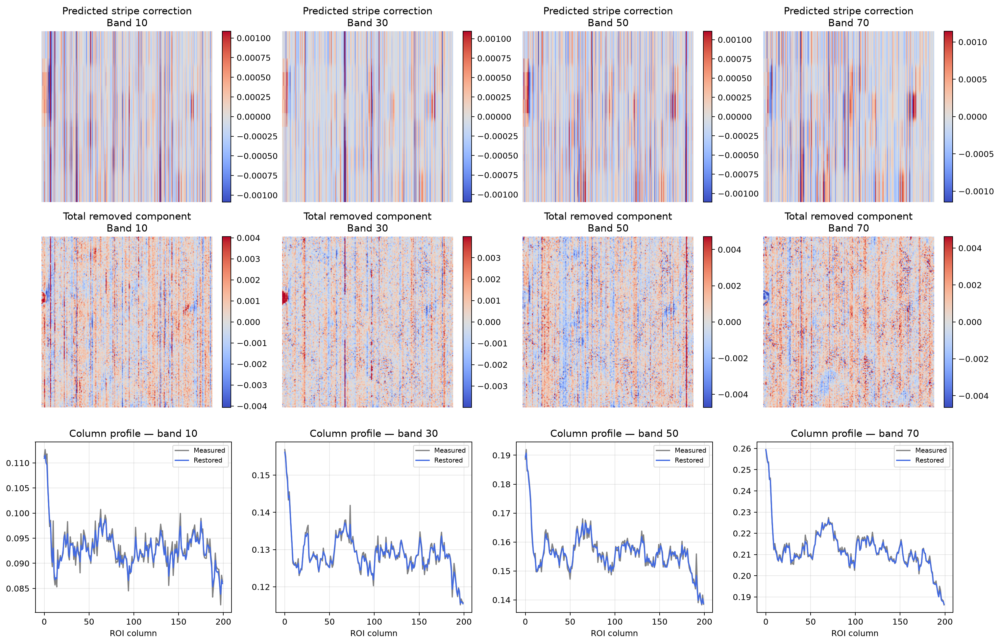

### IIRS

  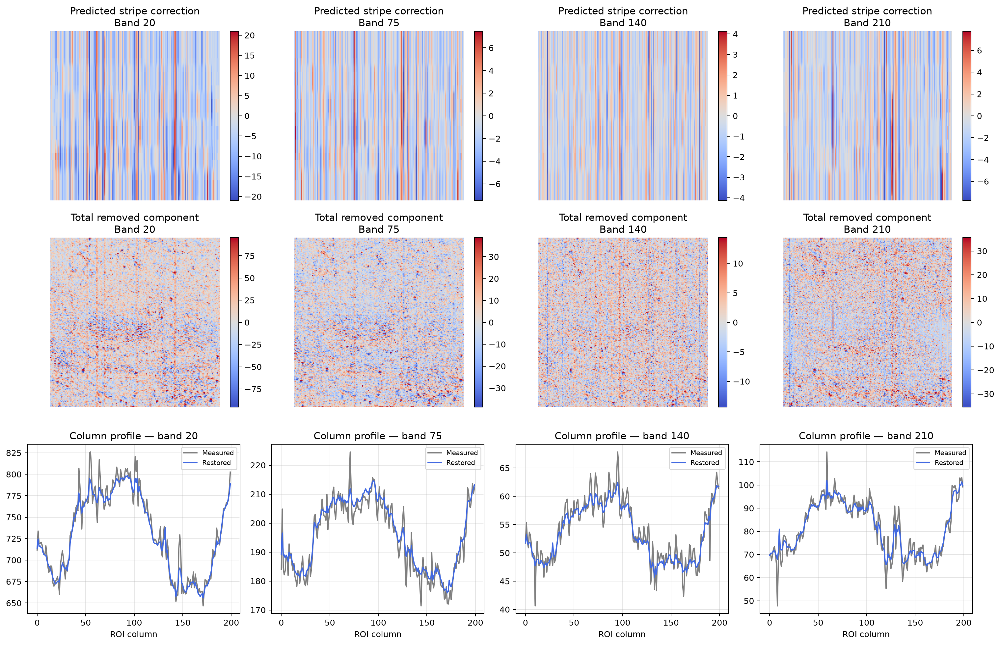

Residuals show changes made by the model.

## Spectral Comparison

  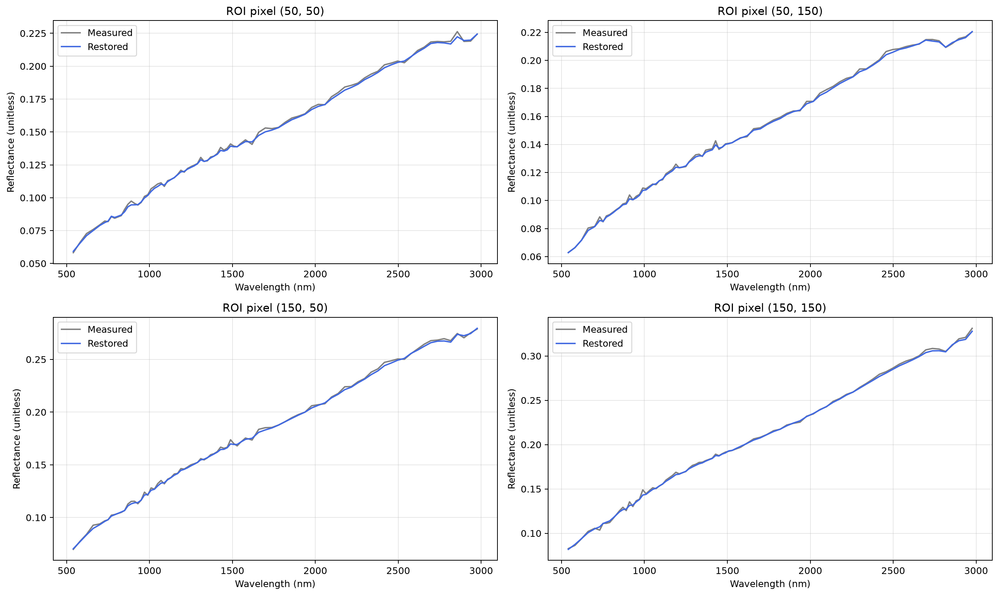

## Ablation Study

  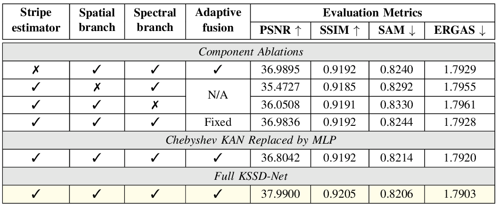

The ablations examine removal of the stripe estimator, spatial branch, and spectral branch; replacement of adaptive fusion with fixed equal-weight fusion; and replacement of Chebyshev-KAN mappings with MLPs.

## Model Size and Runtime

| Comparison | Reported result |
|---|---:|
| KSSD-Net trainable parameters | 28,252 |
| Parameter-count reduction relative to DPNet-S | 86.49% |
| Mean inference time | 10.3296 s |
| Mean inference-time reduction relative to SST | 53.30% |

Runtime values correspond to the reported benchmark configuration. Parameter count, FLOPs, and execution time measure different aspects of computational requirements.

## Training Configuration

| Setting | Value |
|---|---|
| Training patch size | 32 × 32 |
| Batch size | 2 |
| Maximum epochs | 50 |
| Optimization steps per epoch | 2,000 |
| Optimizer | AdamW |
| Initial learning rate | 2 × 10⁻⁴ |
| Final learning-rate target | 1 × 10⁻⁵ |
| Weight decay | 1 × 10⁻⁵ |
| Gradient-norm clipping | 1 |

Invalid measurements are excluded using validity masks. Per-band normalization uses training-set statistics, which are retained for validation, testing, and inverse normalization. Masked auxiliary reconstruction is used during training and does not require a separate inference stage.
